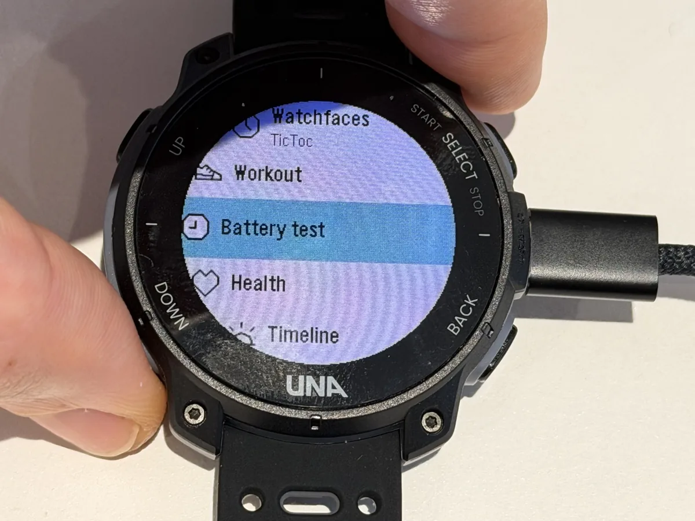

> [!IMPORTANT]
> **unapebble: PebbleOS for the UNA Watch.** This is an unofficial fork of
> [PebbleOS](https://github.com/coredevices/PebbleOS) with a port to the
> [UNA Watch](https://github.com/UNAWatch/una-kernel-public), an STM32U5A5
> smartwatch. It is not affiliated with or endorsed by Core Devices LLC or UNA
> Watch Ltd; see [NOTICE](NOTICE).
>
> **Experimental.** Parts of the port have run on a watch (the display, the
> buttons, the eMMC storage, the battery charger and fuel gauge, USB); much has
> not, and Bluetooth, GNSS and most sensors have no drivers yet. The firmware
> charges the battery (to 4.36 V, under the stock firmware's 4.40 V): run it at
> your own risk.
>
> - **Board documentation:** [`docs/boards/unawatch`](docs/boards/unawatch/index.md),
>   with how to build, install and recover, the hardware notes, and the
>   [decision log](docs/boards/unawatch/decisions/index.md).
> - **Install and recover:** the watch's own bootloader installs a `.ota` file
>   from its USB drive (hold the power button for 4 s as the watch turns on), and
>   puts the stock firmware back the same way. Nothing in this repository replaces
>   the bootloader.
> - **The update key** in `tools/una/SecurityKeys.pem` is the one every UNA Watch
>   uses, published by UNA Watch Ltd. It is not a secret.
> - **Build:** in Docker, see [`docker/README.md`](docker/README.md).

  
  &nbsp;
  

  

  
  
  

## Resources

Here's a quick summary of resources to help you find your way around:

### Getting Started

- 📖 [Documentation](https://pebbleos.readthedocs.io/latest)
- 🚀 [Quickstart](https://pebbleos.readthedocs.io/latest/getting_started/index.html)

### Code and Development

- ⌚ [Source Code Repository](https://github.com/coredevices/PebbleOS)
- 🐛 [Issue Tracker](https://github.com/coredevices/PebbleOS/issues)
- 🤝 [Contribution Guide](CONTRIBUTING.md)

### Community and Support

- 💬 [Discord](https://discordapp.com/invite/aRUAYFN)
- 👥 [Discussions](https://github.com/coredevices/PebbleOS/discussions)
