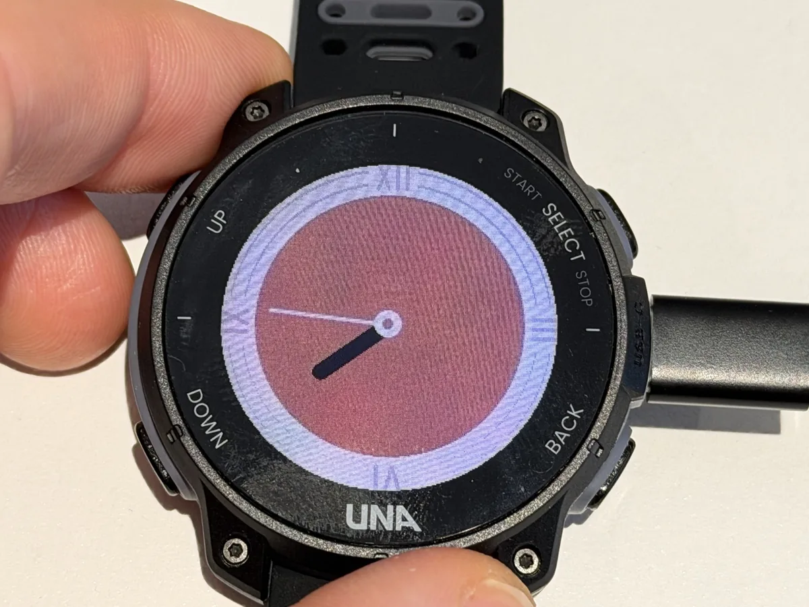
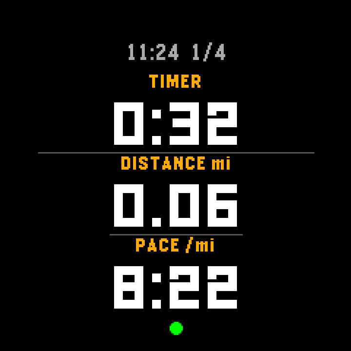
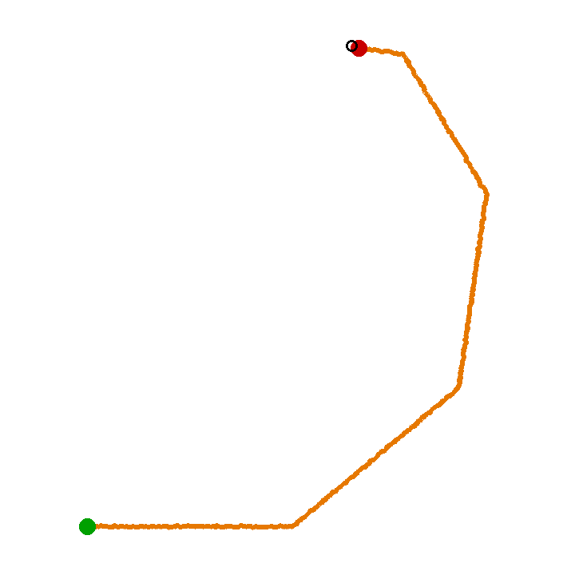
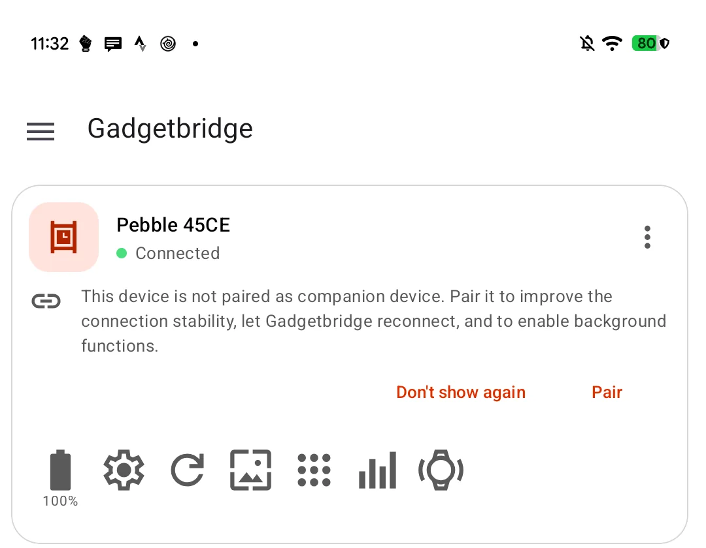

> [!IMPORTANT]
> **unapebble: PebbleOS for the UNA Watch.** This is an unofficial fork of
> [PebbleOS](https://github.com/coredevices/PebbleOS) with a port to the
> [UNA Watch](https://github.com/UNAWatch/una-kernel-public), an STM32U5A5
> smartwatch. It is not affiliated with or endorsed by Core Devices LLC or UNA
> Watch Ltd; see [NOTICE](NOTICE).
>
> **Experimental.** On a watch so far: the display, the buttons, the eMMC
> storage, the battery charger and fuel gauge, USB, the accelerometer,
> magnetometer and barometer, GPS, and Bluetooth with an Android phone through
> Gadgetbridge (pairing, time, notifications). Heart rate has no driver yet,
> and GPS and step counting have not been tested outdoors. The firmware charges
> the battery (to 4.36 V, under the stock firmware's 4.40 V): run it at your own
> risk.
>
> - **GPS workouts:** Run, Walk and Bike record with the watch's own GPS, no
>   phone needed, and export as FIT files for Strava or Garmin Connect: see
>   [`workouts.md`](docs/boards/unawatch/workouts.md).
> - **Phone:** pair with an Android phone through Gadgetbridge for the time,
>   notifications and calls: see [`phone.md`](docs/boards/unawatch/phone.md).
> - **Board documentation:** [`docs/boards/unawatch`](docs/boards/unawatch/index.md),
>   with how to build, install and recover, the hardware notes, and the
>   [decision log](docs/boards/unawatch/decisions/index.md).
> - **Install and recover:** the watch's own bootloader installs a `.ota` file
>   from its USB drive (hold the power button for 4 s as the watch turns on), and
>   puts the stock firmware back the same way. Nothing in this repository replaces
>   the bootloader.
> - **The update key** in `tools/una/SecurityKeys.pem` is the one every UNA Watch
>   uses, published by UNA Watch Ltd. It is not a secret.
> - **Build:** in Docker, see [`docker/README.md`](docker/README.md).
> - **Downloads and CI:** the [releases](https://github.com/aquarat/unapebble/releases)
>   have the `.ota` of the latest main (`unawatch-latest`) and of each `v*` tag,
>   built by [GitHub Actions](https://github.com/aquarat/unapebble/actions).
> - **This repository is a read-only mirror.** Development happens in the
>   maintainer's own repository, which pushes here and overwrites anything
>   merged on GitHub; an accepted pull request is applied there, its author kept.

  
  &nbsp;
  

  
  &nbsp;
  

  
  &nbsp;
  

  

  
  
  

## Resources

Here's a quick summary of resources to help you find your way around:

### Getting Started

- 📖 [Documentation](https://pebbleos.readthedocs.io/latest)
- 🚀 [Quickstart](https://pebbleos.readthedocs.io/latest/getting_started/index.html)

### Code and Development

- ⌚ [Source Code Repository](https://github.com/coredevices/PebbleOS)
- 🐛 [Issue Tracker](https://github.com/coredevices/PebbleOS/issues)
- 🤝 [Contribution Guide](CONTRIBUTING.md)

### Community and Support

- 💬 [Discord](https://discordapp.com/invite/aRUAYFN)
- 👥 [Discussions](https://github.com/coredevices/PebbleOS/discussions)
